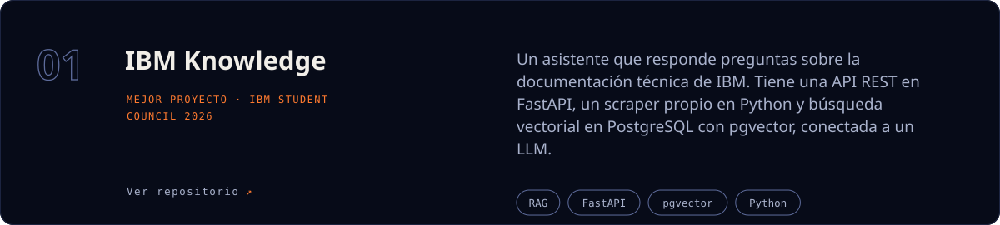
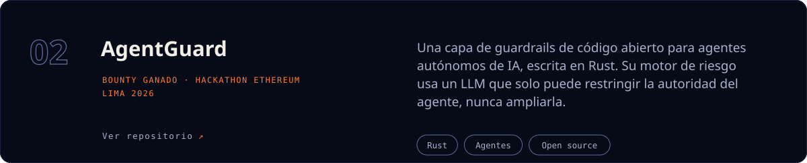
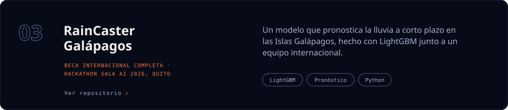

  
  
  

 

## Donde ya lo hice

**IBM** · Cloud Customer Success Specialist · Abr 2025 a hoy 
Construí de punta a punta un **sistema de IA contra el lavado de activos** para Financiera Efectiva, con watsonx.ai y agentes en watsonx Orchestrate. Hoy se ofrece a otros bancos. Soy el contacto técnico de clientes corporativos en Perú, Colombia y Ecuador.

**Cyancloud** · Consultor de Infraestructura Cloud, luego Tech Lead · Nov 2025 a Jun 2026 · Cliente: ONPE 
Lideré el equipo de ingeniería de **más de 8 sistemas de las Elecciones Generales Perú 2026**, en una arquitectura híbrida de AWS y on‑premises: resultados en tiempo real y cómputo de votos con firma digital.

## Lo que construyo por mi cuenta

## Lo que aprendo, lo enseño

**AWS Student Builder Group UNI** · Líder. Abrí una cohorte de AWS Academy con 457 estudiantes y construí [aws-uni.com](https://aws-uni.com). [Únete ↗](https://linktr.ee/AWSCloudClubUNI)

**Developer Student Club UNI** · Vicepresidente. Eventos de datos, IA, cloud y redes para estudiantes de ingeniería. [Ven al próximo ↗](https://devsc.netlify.app/)

## Mi stack, capa por capa

<table>
<tr><td width="170"><b>IA y GenAI</b> Lo que decide</td><td><code>watsonx Orchestrate</code> <code>watsonx.ai</code> <code>Agentes de IA</code> <code>RAG</code> <code>LangChain</code> <code>LightGBM</code> <code>Búsqueda vectorial</code></td></tr>
<tr><td><b>Código y datos</b> De qué está hecho</td><td><code>Python</code> <code>SQL</code> <code>Bash</code> <code>FastAPI</code> <code>PostgreSQL</code></td></tr>
<tr><td><b>DevOps</b> Cómo llega</td><td><code>Terraform</code> <code>Docker</code> <code>Kubernetes</code> <code>GitHub Actions</code> <code>AWS CodeDeploy</code> <code>Linux</code> <code>Git</code></td></tr>
<tr><td><b>Cloud</b> Donde corre</td><td><code>Amazon EKS</code> <code>ECS</code> <code>EC2</code> <code>RDS Aurora</code> <code>S3</code> <code>CloudFront</code> <code>OpenShift</code> <code>IBM Kubernetes Service</code> <code>VPC</code></td></tr>
</table>

 

<b>¿Tienes algo que aterrizar?</b> Escríbeme por <a href="https://www.linkedin.com/in/cesar-carrasco-rojas">LinkedIn</a>. Respondo yo, no un bot.

